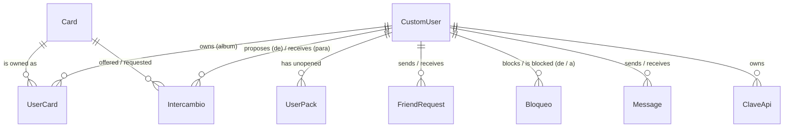

*This project has been created as part of the 42 curriculum by nmagro-r, pablalva, smarquez, ksudyn, osmunoz-.*

# 🎴 42 Card Album — ft_transcendence

A collectible card web application built from public 42 Intra data: every
student of the 42 Madrid common core becomes a card, and the card's rarity
comes from that student's real grade and level.

## Table of Contents

1. [Description](#1-description)
2. [Instructions](#2-instructions)
3. [Team Information](#3-team-information)
4. [Project Management](#4-project-management)
5. [Technical Stack](#5-technical-stack)
6. [Database Schema](#6-database-schema)
7. [Features List](#7-features-list)
8. [Modules & Point Breakdown](#8-modules--point-breakdown)
9. [Individual Contributions & Challenges Faced](#9-individual-contributions--challenges-faced)
10. [Resources & AI Usage](#10-resources--ai-usage)
11. [Known Limitations](#11-known-limitations)

---

## 1. Description

**42 Card Album** is a web application where 42 Madrid students collect cards
of each other. A synchronization engine reads the 42 Intra API and turns every
student of the Madrid common core into a card. Players open card packs in a 3D
scene, complete their album, trade duplicates with their friends, exchange
spare cards for better ones, chat, and compete on a leaderboard. The interface
is available in Spanish, English and Arabic.

**Goal:** build something that only makes sense on campus. The cards are the
people sitting next to you, and trading them gives you a reason to turn around
and talk to them.

> ℹ️ **Note for evaluators:** this is a **collectible card platform**, not a
> match-based game such as Pong, so no "Gaming" game modules are claimed.
> "Points" means the **collection score**: every *distinct* card in your album
> is worth points according to its rarity (duplicates add nothing). The
> leaderboard ranks players by that score.

### Key Features

- **Cards from real 42 data:** one card per Madrid common-core student who
  passes the sync filters, with a rarity derived from their grade and level.
- **3D pack opening:** packs rendered with Three.js, opened by dragging to
  tear them.
- **Packs:** 3 free common packs every day, plus rare and epic packs earned by
  discarding duplicates. Each pack holds 5 cards.
- **Trades between friends:** swap one duplicate for another; proposals expire
  after 3 days.
- **Contracts:** hand in 4 spare cards of one rarity to get 1 card of the next
  rarity, preferably one you do not own yet.
- **Social:** friend requests, online status, and private chat between friends
  with read receipts and blocking.
- **Leaderboard and achievements:** top 50 by points or by distinct cards,
  plus 11 achievements with progress bars.
- **Two ways to log in:** 42 OAuth 2.0, or email and password.
- **3 languages and RTL:** Spanish, English and Arabic, with right-to-left
  layout for Arabic.
- **Public API:** key-protected REST API with rate limiting and an
  auto-generated documentation page.
- **PWA:** installable, and the app shell opens offline.
- **GDPR:** download your data as JSON, CSV or HTML (with an email copy), and
  delete your account after a typed confirmation.
- **Legal pages:** Privacy Policy and Terms of Service in the 3 languages,
  linked from the footer of every screen.

---

## 2. Instructions

### Prerequisites

- **Docker Engine with Docker Compose v2** (the `docker compose` command).
- **GNU Make.** Every `make` target below is a plain `docker compose` command,
  so it can also be typed by hand.
- **Git.**
- **Google Chrome**, latest stable version: the browser the project is tested
  on.
- **Free ports:** `3000` (web app), `4173` (PWA demo), `8000` (backend) and
  `5432` (PostgreSQL).
- **A 42 Intra API application** (UID and secret), created at
  `profile.intra.42.fr` → **Settings** → **API**. Register
  `https://localhost:3000` as its redirect URI.

Nothing else is needed on the host: Python 3.12, Node 20 and PostgreSQL 16 run
inside the containers.

### Step 1 — Configure the environment (`.env`)

```bash
cp .env.example .env
```

The template comments are in Spanish because they were written for the team.
The lines you must fill in are marked `RELLENAR` ("fill in"):

| Variable | What it is for | Required? |
| :--- | :--- | :--- |
| `CLIENT_ID_NACHO`, `CLIENT_SECRET_NACHO` | The 42 application used by the **web login** (42 OAuth). | Only for the 42 login. Email login works without them. |
| `CLIENT_ID_PABLO`, `CLIENT_SECRET_PABLO` | The 42 application used by the **card sync** commands (`make start`, `make sync-quick`, `make sync-full`). It can be the same application as above. | Without them the app starts, but the card catalogue stays empty. |
| `FORTYTWO_REDIRECT_URI` | Already set to `https://localhost:3000`. | Must match three things **letter by letter**: the address in the browser, this variable and the redirect URI registered in your 42 application. No trailing slash. |
| `EMAIL_HOST_USER`, `EMAIL_HOST_PASSWORD` | A Gmail account and an app password, used for the GDPR emails. | Optional. If left empty, nothing breaks: the emails are simply not sent. |

Everything else in the template (database, Django, CORS/CSRF origins,
`VITE_API_URL=/api`) works as it is on a single machine.

> ⚠️ Docker reads `.env` only when it **creates** a container. After editing
> it, run `docker compose up -d --force-recreate`; `docker compose restart` is
> not enough.
>
> `.env` is ignored by Git and must never be committed. Only `.env.example`
> is in the repository.

### Step 2 — Build and start

```bash
make start
```

This single command:

1. builds the images and starts the three containers (`db`, `backend`,
   `frontend`) in the background,
2. waits until the backend has applied its migrations (the backend runs
   `migrate` every time it starts),
3. runs a quick card sync: the first page (100 records) of the Madrid
   common-core list, minus the accounts the filters skip, plus the cards of
   the 5 team members.

Without Make, `docker compose up -d --build` starts everything, but the
catalogue stays empty until a sync is run.

### Step 3 — Open the application

👉 **[https://localhost:3000](https://localhost:3000)**

The certificate is self-signed, so Chrome shows a warning once: accept it and
continue. Create an account with email and password, or use **Log in with
42**. You get 3 free common packs every day: open them in the pack shop.

### Running it from several machines (how we demo it)

The setup above only works on the machine that runs the containers. For
several people to use it at the same time, **every browser must open the site
at the same address**, because the 42 login sends that address to 42 as its
`redirect_uri`. Choose one address for the host machine, written `<HOST>`
below:

- **its IP address** on the local network. This needs no admin rights, and it
  is what we use on the campus computers; or
- **a name** such as `transcendence.42.fr`, if every machine can add it to
  `/etc/hosts` (this needs `sudo`).

Then:

**1. Four variables in the `.env` of the host machine**

```bash
DJANGO_ALLOWED_HOSTS=localhost,127.0.0.1,0.0.0.0,<HOST>
CORS_ALLOWED_ORIGINS=https://localhost:3000,https://<HOST>:3000
CSRF_TRUSTED_ORIGINS=https://localhost:3000,https://<HOST>:3000
FORTYTWO_REDIRECT_URI=https://<HOST>:3000
```

**2. The 42 application:** add `https://<HOST>:3000` as a redirect URI. It
accepts several (one per line), so the `localhost` one can stay.

**3. Recreate the containers:** `docker compose up -d --force-recreate`

**4. Check from another machine** that the host can be reached. This must
print `200`:

```bash
curl -sk -o /dev/null -w '%{http_code}\n' https://<HOST>:3000
```

> ⚠️ **Everyone opens `https://<HOST>:3000`, including the host machine.** If
> the host opens `https://localhost:3000`, it sends `localhost` as the
> redirect and the 42 login fails for that person only.
>
> The trade-off: while `FORTYTWO_REDIRECT_URI` points to `<HOST>`, `localhost`
> stops working for the **42 login**. Email and password login keeps working
> from anywhere.

### PWA demo (`make pwa`)

During development the service worker is **not** registered: `main.jsx` only
registers it in the production build. To show the PWA:

1. Add `http://localhost:4173` to `CSRF_TRUSTED_ORIGINS` in `.env` and run
   `docker compose up -d --force-recreate backend`. Without this, Django's CSRF
   check rejects every `POST` coming from the PWA (login, opening packs, daily
   gift, chat) with a `403`.
2. Run `make pwa`. It builds the frontend and serves the production build on
   **`http://localhost:4173`**. It stays in the foreground (`Ctrl+C` stops
   it), and the development server on port 3000 keeps running.
3. Open `http://localhost:4173` **on the host machine itself**. A service
   worker needs a secure context: `http://localhost` always is one, while
   Chrome refuses to register a service worker on an HTTPS page with a
   self-signed certificate. The PWA server still talks to the backend over
   HTTPS.
4. Check that it works:
   - the install icon appears in the address bar;
   - DevTools → **Application** → **Service Workers** shows *activated and
     running*;
   - DevTools → **Network** → **Offline**, then reload: the application shell
     still opens. Card data needs the network.

### Running the tests

```bash
docker compose exec backend python manage.py test
```

This runs 23 backend tests: login, logout and session handling (`users`), and
the chat rules (`chat`). Django creates a separate test database, so your data
is not touched.

### Makefile Commands Reference

| Command | Description |
| :--- | :--- |
| `make` / `make help` | Lists every command. |
| `make start` | Builds the images, starts the containers in the background, waits for the migrations and runs `sync-quick`. |
| `make start_full` | Same as `start`, but runs the full sync (`sync-full`). |
| `make build` | Builds the images. |
| `make up` | Starts all containers in the foreground, showing their logs (`Ctrl+C` stops them). |
| `make up_silent` | Starts all containers in the background. |
| `make down` | Stops and removes the containers. The database is kept. |
| `make down_clean` | ⚠️ Stops the containers **and deletes the volumes**: the database and the frontend's `node_modules`. |
| `make recreate SERVICE=<name>` | Recreates one container, for example after changing `.env`. |
| `make restart` | Restarts the containers. Does **not** reload `.env`. |
| `make logs` | Live logs of all services, or of one: `make logs SERVICE=backend`. |
| `make migrate` | Applies pending Django migrations. |
| `make migrations` | Creates new migrations from the models. |
| `make shell` | Opens the Django shell. |
| `make superuser` | Creates an administrator for the Django admin panel (`https://localhost:8000/admin/`). |
| `make sync-quick` | Syncs the first page of the Madrid common-core list (100 records, some skipped by the filters) plus the 5 team members' cards. |
| `make sync-full` | **Full campus sync:** requests the profile of every student who passes the filters, pausing between requests to respect the 42 API rate limit. It takes several minutes. |
| `make insert_login LOGIN=<login>` | Creates or updates the card of one student. |
| `make pwa` | Builds the frontend and serves the PWA on `http://localhost:4173` (see [PWA demo](#pwa-demo-make-pwa)). |

---

## 3. Team Information

| Login | Assigned Role(s) | Primary Responsibilities |
| :--- | :--- | :--- |
| **`nmagro-r`** | Tech Lead · Developer (backend) | System architecture and technical decisions. OAuth 2.0 authentication, Public API, PWA integration, chat backend, and code review/merge management. |
| **`pablalva`** | Product Owner (PO) · Developer (backend, DevOps) | Product vision and feature priorities. 42 API synchronization engine (module of choice). Core game logic: rarity algorithms, card economics, point system, trading contracts, friend systems, leaderboard rankings, GDPR compliance (data export & deletion), Docker Compose, and Makefile infrastructure. |
| **`smarquez`** | Developer (frontend) | Full internationalization (3 languages + RTL layout), interactive 3D card pack opening with Three.js, motion animations, and visual styling/color palette design. |
| **`ksudyn`** | Developer (frontend) | Card visual design, rarity neon effects, Creator tier cards, album/catalog view, pack store UI, pagination, filter controls, and private chat UI. |
| **`osmunoz-`** | Project Manager (PM) · Documentation | Facilitated team coordination, removed technical obstacles, aligned UI requirements with DB schemas, and authored the project README. |

---

## 4. Project Management

- **Work organization:** the work was mainly split between backend
  (`nmagro-r`, `pablalva`) and frontend (`smarquez`, `ksudyn`). The frontend
  built each screen first with sample data. When it needed data that did not
  exist yet, it asked the backend, which created the endpoint and connected
  the screen. `pablalva` set the priorities as Product Owner and `osmunoz-`
  coordinated the team as Project Manager.
- **Branches:** each task was developed in its own branch (for example
  `konrad_filtro_tiempo`, `nacho/traducir-logros` or `makefile`) and then
  merged into `lab/db/test`, the common integration branch. `main` holds the
  final version: the integrated code is moved there once the project is
  finished.
- **Code reviews:** larger changes were proposed as GitHub pull requests (21
  in total), so that a teammate could review them before merging. Smaller
  fixes were pushed directly to `lab/db/test`.
- **Tools:** GitHub (branches and pull requests) to organize and review the
  work.
- **Meetings & communication:** weekly meetings on Mondays at the 42 Madrid
  campus, regular calls on Discord, and a WhatsApp group for day-to-day
  coordination.

---

## 5. Technical Stack

### Frontend

- **React 18.3 + Vite 5.4.** React is the frontend framework of the Web
  module. Vite gives a fast development server with hot reload, an HTTPS
  certificate (`@vitejs/plugin-basic-ssl`) and a proxy that forwards `/api`
  to the backend, so the browser only talks to one address.
- **react-router-dom 6.22:** client-side routing of the single-page
  application.
- **Three.js 0.185:** the 3D pack opening scene and the animated background
  of the pack shop.
- **framer-motion 12:** card flips, card dealing and page transitions.
- **Styling solution — our own design system** (no CSS framework, no UI kit):
  - 64 design tokens as CSS custom properties in `frontend/src/styles.css`:
    color scales, semantic surface/text/border colors, one color and one
    gradient per rarity, a type scale, two font families, a spacing scale,
    radii and easing curves;
  - 12 reusable React components in `frontend/src/components/ui.jsx`
    (`Button`, `SecondaryButton`, `Card`, `TextField`, `SelectField`,
    `Alert`, `Badge`, `Avatar`, `ProgressBar`, `Modal`, `StatusDot`,
    `IconButton`).

  We chose this over a framework because every rarity has its own colors and
  effects. Tokens keep those colors identical on every screen, and changing a
  token changes it everywhere.

### Backend

- **Django 5.1.8 + Django REST Framework 3.15.2.** Django is the backend
  framework of the Web module. It brings the ORM, migrations, password
  hashing, sessions, CSRF protection and the admin panel. DRF adds API views
  and request throttling.
- **django-extensions (`runserver_plus`) + Werkzeug + pyOpenSSL:** serve the
  backend over HTTPS with a self-signed certificate generated at startup.
- **django-cors-headers 4.4:** whitelist of origins allowed to call the API.
- **requests:** calls to the 42 Intra API (OAuth and card sync).
- **Pillow 11.0:** validates uploaded avatars (JPEG, PNG or WebP, 2 MB
  maximum), shrinks them to 512 px at most and re-encodes them as JPEG, which
  also drops their EXIF metadata.

### Database

- **PostgreSQL 16.** The data is relational: users own cards, a trade links
  two users and two cards, and friendships and blocks link pairs of users. We
  rely on what a relational database enforces:
  - foreign keys with `ON DELETE CASCADE`, so deleting an account deletes
    everything that belongs to it (GDPR);
  - unique constraints, for example one album row per user and card;
  - row locks (`SELECT … FOR UPDATE`) inside transactions, so that two
    requests arriving at the same time cannot spend the same card twice.

### Infrastructure & Security

- **Docker Compose:** three services (`db`, `backend`, `frontend`), started
  with a single command.
- **HTTPS without a reverse proxy:** the browser only talks to the Vite server
  on port 3000, over HTTPS. Vite forwards `/api` and `/static` to Django over
  HTTPS as well. Only the connection between Django and PostgreSQL, inside the
  Docker network, is unencrypted, which the subject allows.
- **Authentication:** server-side sessions stored in the database. The
  cookies are `Secure` with `SameSite=None`, and every write request carries
  a CSRF token (`X-CSRFToken`). Passwords are hashed with PBKDF2-SHA256 and a
  per-user salt (Django's default) and checked by Django's 4 password
  validators. Every endpoint requires a session, except the health check and
  the API documentation page.
- **Secrets:** all credentials live in a git-ignored `.env`; `.env.example`
  documents them.

### Multi-user support

Every action that moves cards or packs runs inside a database transaction
with locked rows: opening a pack, accepting a trade, a contract, a discard and
the daily gift. Two simultaneous requests (for example a double click, or two
browsers) are processed one after the other, so no card is lost or created
twice. Online status, chat messages and trade proposals refresh by polling
(see [Known Limitations](#11-known-limitations)).

---

## 6. Database Schema

9 models of our own, spread over 5 Django apps (`users`, `cards`, `social`,
`chat`, `publicapi`), plus Django's built-in tables (sessions, permissions,
admin log). Every foreign key to a user is `on_delete=CASCADE`.



Field and model names are in Spanish, as in the code. Their meaning is given
in English.

**`CustomUser`** (`users`): extends Django's `AbstractUser`, which provides
`username`, the hashed `password`, `first_name`, `last_name`, `date_joined` and
`last_login`.

| Field | Type | Notes |
| :--- | :--- | :--- |
| `email` | `EmailField`, unique, nullable | Login for email accounts. |
| `id_42` | `IntegerField`, unique, nullable | Set only for 42 OAuth accounts. |
| `profile_image` | `URLField(500)` | Intra photo. |
| `avatar` | `ImageField` | Uploaded avatar. Without one, a generated avatar with the user's initial is shown. |
| `nombre_mostrado` | `CharField(50)` | Display name. |
| `bio` | `TextField(500)` | Biography. |
| `estado` | `CharField(10)`: `online` / `offline` | Shown as offline after 5 minutes without activity. |
| `ultima_actividad` | `DateTimeField` | Last activity, updated at most once a minute. |
| `ultimo_regalo_diario` | `DateField` | Day the daily gift was last claimed. |
| `is_alumni` | `BooleanField` | From the Intra. |

**`Card`** (`cards`): the catalogue, filled by the sync engine.

| Field | Type | Notes |
| :--- | :--- | :--- |
| `login` | `CharField(10)`, unique | The student's 42 login. |
| `title` | `CharField(100)` | The title selected on the Intra. |
| `coalition` | `CharField(50)` | One of the 4 Madrid coalitions. |
| `cursus_lvl` | `FloatField` | Common-core level. |
| `eval_point` | `IntegerField` | Evaluation points. |
| `altarians` | `IntegerField` | Intra wallet. |
| `photo` | `URLField(500)` | Intra photo. |
| `tier` | `CharField(50)` | Rarity: `Junior`, `Senior`, `Transcender`, `Legendario` (Legendary), `Staff` or `Creator`. |
| `created_at` | `DateTimeField` | |

**`UserCard`** (`cards`): one row per user and card. Unique on (`user`, `card`).

| Field | Type | Notes |
| :--- | :--- | :--- |
| `user` | FK → `CustomUser` | |
| `card` | FK → `Card` | |
| `cantidad` | `PositiveIntegerField` | Number of copies (quantity). |
| `fecha_obtencion` | `DateTimeField` | When the card was first obtained. |

**`UserPack`** (`cards`): unopened packs. Unique on (`user`, `tipo_sobre`).

| Field | Type | Notes |
| :--- | :--- | :--- |
| `user` | FK → `CustomUser` | |
| `tipo_sobre` | `CharField(20)`: `comun` / `raro` / `epico` | Pack type: common, rare or epic. |
| `cantidad` | `PositiveIntegerField` | Number of packs. |

**`Intercambio`** (`cards`): a trade proposal.

| Field | Type | Notes |
| :--- | :--- | :--- |
| `de`, `para` | FK → `CustomUser` | From (proposer) and to (receiver). |
| `carta_ofrecida`, `carta_pedida` | FK → `Card` | Offered card and requested card. |
| `estado` | `CharField(10)`: `PENDIENTE` / `ACEPTADO` / `RECHAZADO` / `CANCELADO` | Pending, accepted, rejected or withdrawn. |
| `created_at` | `DateTimeField` | Proposals older than 3 days count as expired. |
| `resuelto_en` | `DateTimeField`, nullable | When it was resolved. |

**`FriendRequest`** (`social`): unique on (`sender`, `receiver`).

| Field | Type | Notes |
| :--- | :--- | :--- |
| `sender`, `receiver` | FK → `CustomUser` | |
| `status` | `CharField(10)`: `PENDING` / `ACCEPTED` / `DECLINED` | An accepted request is a friendship. |
| `created_at` | `DateTimeField` | |

**`Bloqueo`** (`social`): a block, in one direction. Unique on (`de`, `a`).

| Field | Type | Notes |
| :--- | :--- | :--- |
| `de`, `a` | FK → `CustomUser` | Who blocks and who is blocked. |
| `created_at` | `DateTimeField` | |

**`Message`** (`chat`): a private message.

| Field | Type | Notes |
| :--- | :--- | :--- |
| `sender`, `receiver` | FK → `CustomUser` | |
| `texto` | `TextField`, 1000 characters maximum | Message text. |
| `leido` | `BooleanField` | Read flag, shown as read receipts. |
| `created_at` | `DateTimeField` | |

**`ClaveApi`** (`publicapi`): a key for the public API.

| Field | Type | Notes |
| :--- | :--- | :--- |
| `usuario` | FK → `CustomUser` | Owner. |
| `nombre` | `CharField(60)` | Name given by the user. |
| `huella` | `CharField(64)`, unique | SHA-256 digest of the key. The key itself is never stored. |
| `prefijo` | `CharField(8)` | First characters of the key, to tell keys apart. |
| `activa` | `BooleanField` | A deactivated key is rejected. |
| `created_at`, `ultimo_uso` | `DateTimeField` | Creation and last use. |

---

## 7. Features List

| # | Feature | Team member(s) | What it does |
| :--- | :--- | :--- | :--- |
| 1 | **42 OAuth 2.0 login** | `nmagro-r` | Log in with the 42 Intra. The first login creates the account; later logins refresh the name, email and photo. No 42 password is ever stored. |
| 2 | **Email & password authentication** | `nmagro-r` | Sign-up and login with email, validated in the browser and on the server. Passwords are salted and hashed (PBKDF2-SHA256). Logging out closes the session in every browser. |
| 3 | **42 campus synchronization engine** | `pablalva` | Django commands that turn the Madrid common-core students into cards (see the [module of choice](#-module-of-choice-justification-42-api-synchronization-engine-2-points)). |
| 4 | **Rarity & point system** | `pablalva` | Rarity from grade and level: Junior, Senior, Transcender, Legendary, Staff and Creator. Each rarity is worth 10, 25, 60, 200, 300 or 500 points. |
| 5 | **Album & search catalogue** | `ksudyn`, `smarquez` | Your album with live text search (login, title or coalition), a rarity filter, an "obtained in the last 24 h / 7 days / 30 days" filter, 4 sort orders and pagination. |
| 6 | **Card visuals & neon effects** | `ksudyn`, `smarquez` | Borders, colors and glow per rarity, an electric border for Staff cards, and special Creator cards. |
| 7 | **3D interactive pack opening** | `smarquez` | A holographic pack rendered in Three.js. You rotate it and tear it open by dragging, then the 5 cards are dealt and flipped. |
| 8 | **Pack store & inventory** | `ksudyn` | Three pack types (common, rare, epic) of 5 cards each, each with its own odds per rarity. Packs are not bought: they come from the daily gift and from discards. |
| 9 | **Discard duplicates for packs** | `nmagro-r`, `smarquez`, `ksudyn` | Hand in 4 copies of the same card to get 1 pack of the matching quality (Junior → common, Senior → rare, higher rarities → epic). You always keep at least one copy. |
| 10 | **Contract upgrades** | `pablalva`, `nmagro-r` | Hand in 4 spare cards of the same rarity to get 1 card of the next rarity, preferably one you do not own yet. You always keep at least one copy of each card. |
| 11 | **Peer-to-peer trading** | `pablalva`, `ksudyn` | Propose one of your duplicates for one of a friend's duplicates. The friend accepts or rejects; both cards change hands at once, or neither does. Proposals expire after 3 days. |
| 12 | **Friends system & online status** | `pablalva`, `nmagro-r` | Search users, send and answer friend requests, remove friends, and see who is online. |
| 13 | **Private messaging** | `ksudyn`, `nmagro-r` | One-to-one chat between friends, with read receipts, unread counters and blocking (a block stops messages in both directions; old messages stay). |
| 14 | **Global leaderboard** | `pablalva` | Top 50 players by points (default) or by number of distinct cards. |
| 15 | **User profile & achievements** | `ksudyn` | Display name, biography, avatar upload, collection statistics, 11 achievements with progress bars, and a link to the 42 Intra profile. |
| 16 | **Daily gift** | `pablalva` | 3 free common packs once per calendar day (Madrid time). |
| 17 | **Internationalization & RTL** | `smarquez` | Spanish, English and Arabic, switchable from the interface. Arabic switches the page to right-to-left. |
| 18 | **Public REST API** | `nmagro-r` | Read the catalogue and your album, trade and manage your keys from a script (see [Modules](#8-modules--point-breakdown)). |
| 19 | **Progressive Web App** | `nmagro-r` | Installable app with a service worker that caches the application shell. |
| 20 | **GDPR compliance** | `pablalva`, `osmunoz-` | Download all your data as JSON, CSV or HTML (with a copy sent by email), and delete your account, including your avatar file. |
| 21 | **Legal pages** | `nmagro-r` | Privacy Policy and Terms of Service in the 3 languages, linked from the footer. |
| 22 | **Container infrastructure** | `pablalva` | Docker Compose, the Makefile and HTTPS on both servers. |

---

## 8. Modules & Point Breakdown

**Total claimed: 21 points** (12 from 6 Major modules + 9 from 9 Minor
modules). The minimum is 14, and the maximum that counts is 19 (14 + 5 bonus).
We claim 2 points more than that maximum on purpose, as a margin in case a
module is not validated.

### Major Modules (2 points each)

| Module | Team member(s) | Why we chose it | How it is implemented |
| :--- | :--- | :--- | :--- |
| **Web: frameworks for frontend and backend** | All | A full framework on each side gives routing, ORM, sessions and security out of the box. | React 18 + Vite on the frontend; Django 5 + Django REST Framework on the backend. |
| **Web: user interaction** (chat, profiles, friends) | `ksudyn`, `pablalva` | Trading cards only makes sense between people who know each other. | Chat between friends with read receipts and blocking; public profile pages; friend requests, friend list and removal. |
| **User Management: standard user management** | `pablalva`, `ksudyn` | Every player needs an identity in the album and on the leaderboard. | Editable display name and biography; avatar upload with a generated default avatar; friends with online status; profile page with stats and achievements. |
| **Gaming & UX: advanced 3D graphics** | `smarquez` | Opening a pack is the key moment of a card game. | Three.js scene with a perspective camera, physically based materials (`MeshPhysicalMaterial`), image-based lighting (`RoomEnvironment` + `PMREMGenerator`), `OrbitControls`, ray casting to tear the pack by dragging, and `dispose()` of the GPU resources when the scene closes. A Three.js shader also animates the pack shop background. |
| **Web: public API** | `nmagro-r` | Lets players build their own tools on top of the album, such as bots or statistics. | 9 routes under `/api/publica/` with `GET`, `POST`, `PUT` and `DELETE`, authenticated by an `X-API-Key` header. Keys are stored only as SHA-256 digests. Rate limits: 60 reads and 20 writes per minute, answered with HTTP `429`. An auto-generated documentation page lists every route, method and a `curl` example. |
| **Module of choice: 42 API synchronization engine** | `pablalva` | Without it there are no cards: see the justification below. | Two Django management commands and two shared modules (731 lines). |

### Minor Modules (1 point each)

| Module | Team member(s) | Why we chose it | How it is implemented |
| :--- | :--- | :--- | :--- |
| **Web: ORM** | `nmagro-r`, `pablalva` | Schema changes as versioned migrations, and no hand-written SQL. | Django ORM: 9 models and 33 migrations. |
| **User Management: OAuth 2.0** | `nmagro-r` | Every player already has a 42 account. | 42 Intra authorization-code flow. The backend exchanges the code for a token using the secret from `.env`. |
| **Accessibility: multiple languages** | `smarquez` | The campus is international. | Own i18n system with a React context: 347 translation keys in each of Spanish, English and Arabic, a language switcher, and the choice remembered in the browser. The legal pages are translated as well. |
| **Accessibility: RTL support** | `smarquez` | Arabic is one of our three languages. | Choosing Arabic sets `dir="rtl"` and `lang="ar"` on the whole document, so the layout mirrors, and switching back to LTR is instant. |
| **Data: GDPR compliance** | `pablalva`, `osmunoz-` | The album stores personal data of real students. | Data export as JSON, CSV or HTML, with a copy emailed as an attachment. Account deletion requires typing a confirmation sentence; it deletes the avatar file and, for 42 students, their card, and sends a confirmation email. |
| **Web: custom design system** | `ksudyn`, `smarquez` | Consistent rarity colors and a recognisable look on every screen. | 64 design tokens (palette, typography, spacing) and 12 reusable components, described in the [Technical Stack](#5-technical-stack). |
| **Web: advanced search** | `ksudyn` | An album with hundreds of cards needs search to be usable. | Live text search, rarity filter, date filter, 4 sort orders and pagination (8 cards per page). |
| **Gaming & UX: gamification** | `pablalva` | Reasons to come back every day and to complete the album. | Persistent, built from data stored in the database: daily gift, leaderboard by points, and 11 achievements with progress bars computed from the album. |
| **Web: PWA** | `nmagro-r` | Players can install the album like a mobile app. | Web app manifest plus a service worker that caches the app shell and never caches `/api`. Shown with `make pwa`. |

---

### 🌟 Module of Choice Justification: 42 API Synchronization Engine (2 Points)

The engine is made of `fill_db.py` (270 lines) and `login_card.py` (152), two
Django management commands, plus `intra.py` (121) and `rarezas.py` (188), two
shared modules: **731 lines** of Python.

#### 1. Why we chose this module

Without this engine the product does not exist. A card album of 42 students
needs real data about 42 students. The engine connects an external REST API to
our game and turns raw student data into a balanced catalogue.

#### 2. Technical challenges addressed

- **42 API rate limit:** the engine pauses 0.5 s between requests. When the
  API answers `HTTP 429`, it waits (5 s for list pages, 3 s for profiles) and
  retries the same request.
- **Pagination:** it walks the Madrid common-core list (`cursus_id` 21,
  `campus_id` 22) 100 records at a time, until the API returns an empty page.
- **Two JSON shapes for the same student:** `/users/<login>` nests the cursus
  inside the user, while `/cursus_users` nests the user inside the cursus.
  `intra.py` turns both into one structure. `/users/<login>` also returns
  several cursus (piscine and common core), so it picks the common core
  explicitly. Picking the wrong one would produce a card with the wrong level.
- **Rarity rules (`rarezas.py`):** a single source of truth for rarities,
  points and pack odds:
  - grade `Cadet`: **Junior** below level 4, **Senior** from level 4;
  - grade `Transcender` or `Alumni`: **Transcender** below level 14,
    **Legendary** from level 14;
  - **Staff**: students who also work for the campus, detected by Intra
    achievement 65 on their student account;
  - **Creator**: the 5 members of this team.

  An unknown or missing grade falls back to Junior, so a card never ends up
  without a rarity.
- **Filtering:** the engine skips accounts whose login contains "bot", staff
  service accounts (`staff?`), users without a Madrid coalition, level-0
  accounts, and students whose common-core cursus is closed (`end_at` set).
  If a student skipped for a closed cursus or level 0 already had a card, the
  card is deleted. Students who
  deleted their account are never re-created (see the opt-out in
  [Known Limitations](#11-known-limitations)).
- **Fewer requests:** the members of the 4 Madrid coalitions are loaded once
  at the start, a few paginated requests per coalition. Without that, the
  engine would need one extra request per student.
- **Updates in place:** running a sync again updates existing cards (level,
  title, photo, coalition, rarity) instead of duplicating them. A profile that
  fails to load is skipped without stopping the sync.

#### 3. Value added to the project

It turns external student data into the whole playable catalogue, and it keeps
it current: running the sync again refreshes levels and rarities, and removes
students who left the common core.

#### 4. Why it deserves Major status (2 points)

It integrates an external, rate-limited OAuth API (client-credentials flow),
handles pagination, retries and inconsistent JSON shapes, encodes the business
rules that define the whole game economy, and keeps the catalogue consistent
across repeated runs. This is comparable in scope to the other Major modules.

---

## 9. Individual Contributions & Challenges Faced

### `nmagro-r`
- **Contributions:** architected the backend REST APIs, OAuth 2.0 42
  authentication, the Public API with SHA-256 key hashing and rate limiting,
  and the PWA integration.
- **Challenge faced:** OAuth `redirect_uri` mismatches between browser and
  server resulted in silent login failures.
- **Resolution:** standardized the environment configuration in `.env` and
  documented the exact host-matching requirements.

### `pablalva`
- **Contributions:** built the 42 API synchronization engine (module of
  choice). Developed the card rarity algorithms, economy scoring, trading
  contracts, friend systems, leaderboard logic, GDPR data export/deletion
  endpoints, the Docker Compose setup and the Makefile.
- **Challenge faced:** Django's default `user.delete()` deleted database
  records but left uploaded avatar image files orphaned on the disk.
- **Resolution:** implemented explicit disk file removal before the database
  deletion, to satisfy GDPR privacy requirements.

### `smarquez`
- **Contributions:** built the Three.js 3D card pack opening, the i18n
  translation system (347 keys in Spanish, English and Arabic) and the RTL
  layout.
- **Challenge faced:** 3D lighting and performance degradation on lower-end
  client GPUs during pack opening.
- **Resolution:** optimized geometry usage and used `RoomEnvironment` PBR
  image-based lighting for high performance.

### `ksudyn`
- **Contributions:** designed the card visual components, rarity neon glow
  effects, Creator cards, album/catalogue filtering, pack store UI and private
  chat interface.
- **Challenge faced:** hardcoded rarity color mappings went out of sync when
  tier definitions were updated mid-project.
- **Resolution:** centralized the rarity definitions into a single source of
  truth (`rarezas.js`) shared across UI components.

### `osmunoz-`
- **Contributions:** acted as Project Manager (PM) / Scrum Master, facilitating
  team coordination, tracking project milestones and removing technical
  obstacles during decision-making. Guided frontend-driven DB schema planning,
  extended GDPR compliance (CSV/HTML data export & email delivery), and
  consolidated the project README.
- **Challenge faced:** resolving architectural blockers and aligning decoupled
  UI component data needs with backend API contracts.
- **Resolution:** facilitated communication between frontend and backend
  developers to streamline schema design and ensure full subject and GDPR
  documentation compliance.

---

## 10. Resources & AI Usage

### References

- [Django documentation](https://docs.djangoproject.com/) & [Django REST Framework](https://www.django-rest-framework.org/)
- [React documentation](https://react.dev/) & [Vite guide](https://vitejs.dev/)
- [React Router](https://reactrouter.com/)
- [42 Intra API documentation](https://api.intra.42.fr/apidoc)
- [Three.js documentation](https://threejs.org/docs/)
- [MDN: Progressive web apps & service workers](https://developer.mozilla.org/en-US/docs/Web/Progressive_web_apps)
- [MDN: CSS custom properties](https://developer.mozilla.org/en-US/docs/Web/CSS/Using_CSS_custom_properties)
- [PostgreSQL documentation](https://www.postgresql.org/docs/16/)
- [Docker Compose documentation](https://docs.docker.com/compose/)
- [GDPR full text (EUR-Lex)](https://eur-lex.europa.eu/eli/reg/2016/679/oj)

### AI Usage

AI assistants (chat assistants and coding agents) were used during the
project, always with a team member reviewing, testing and committing the
result. What they were used for:

- **Writing and refactoring code with a team member:** backend views and their
  tests, frontend components and styles. Every change was read, tested and
  committed by the person responsible for that part, who must be able to
  explain it.
- **Debugging:** reading error messages, browser console output and server
  logs to find the cause of a bug.
- **Code review:** checking changes before merging them into `lab/db/test`,
  looking for edge cases, race conditions and security issues.
- **Translations:** first drafts of the English and Arabic interface texts and
  of the legal pages, then reviewed by the team.
- **Documentation:** code comments and this README, checked against the code.
- **Subject compliance:** cross-checking the project against the subject and
  the evaluation sheet.

What the team decided, not the AI: the product idea, the game rules
(rarities, points, packs, trades, contracts, discards), the choice of modules
and the priorities.

---

## 11. Known Limitations

- **Polling instead of WebSockets:** the open chat and trade proposals refresh
  every 3 seconds, the unread-message badge every 10 seconds, and the session
  check every 30 seconds.
- **Online status** is based on activity: a user who closes the tab without
  logging out appears offline after 5 minutes.
- **The PWA only runs in the production build** (`make pwa`), on
  `http://localhost:4173` of the host machine, and needs that origin in
  `CSRF_TRUSTED_ORIGINS` (see [PWA demo](#pwa-demo-make-pwa)). Offline, only
  the application shell opens; card data needs the network.
- **Development servers:** the project runs on Vite's development server and
  Django's `runserver_plus`, both with self-signed certificates. It is not
  hardened for production.
- **42 API rate limits:** a full campus sync (`make sync-full`) makes one
  request per student plus a pause between requests, so it takes several
  minutes.
- **Opt-out:** when a 42 student who has a card deletes their account, their
  card is deleted and their login is written to `backend/ignore_logins.txt`
  (git-ignored), so later syncs never re-create it.
- **Expired trades** are not deleted: proposals older than 3 days stop
  counting everywhere, and no background job is needed.
